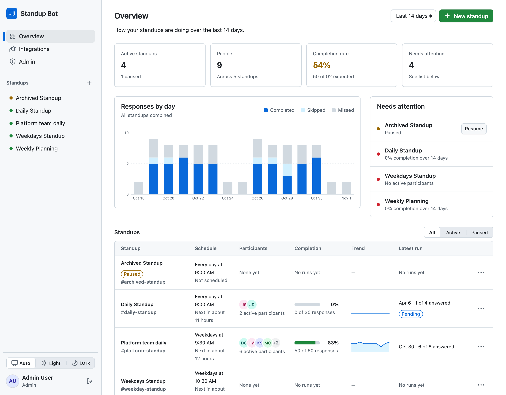
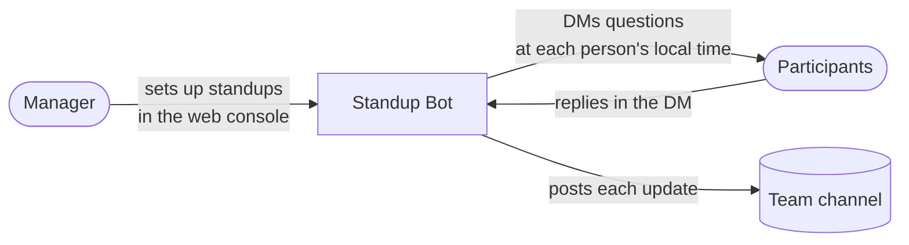
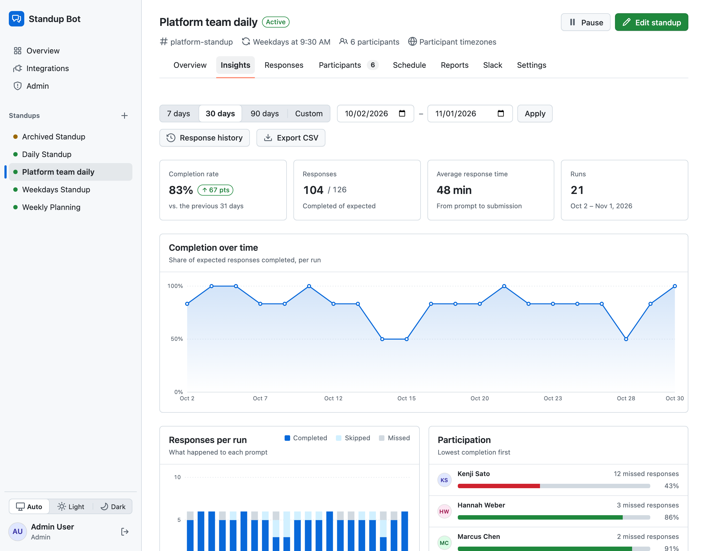

# Standup Bot

Async standups for Slack. Standup Bot DMs each teammate a few questions at a scheduled time (in their own timezone), collects their answers, and posts each person's update to your team's channel. Anyone can sign in with Slack to set up a standup for their team (formal or virtual), manage participants, and see who has responded. Team members can also see their own check-ins and set time away.



## How it works



1. **Define a standup**: pick a channel, a schedule, a few questions, and who's in it. You can do this in the web console or in a YAML file.
2. **The bot checks in**: at the scheduled time, each participant gets a DM and answers the questions one at a time. People who forget get a reminder.
3. **Everyone sees the update**: as soon as someone finishes, their answers are posted to the team channel. Managers can follow participation in the console's responses and insights, and generate summary reports.



## Quick start

All you need is Docker:

```bash
docker compose up --build
```

Then open <http://localhost:3000> and sign in with:

- **Email:** `admin@example.com`
- **Access token:** `local-manager-token`

This runs the whole app (web console, background worker, and Postgres) without connecting to Slack. To have the bot actually send messages, [create a Slack app](docs/slack-setup.md) and [give the app its Slack credentials](docs/getting-started.md#connecting-slack).

## Documentation

| Guide | What's covered |
| --- | --- |
| [Getting started](docs/getting-started.md) | Running locally with Docker Compose or natively with MySQL |
| [Slack setup](docs/slack-setup.md) | Creating the Slack app, scopes, slash commands, and DM commands |
| [Configuration](docs/configuration.md) | Environment variables and YAML standup files |
| [Architecture](docs/architecture.md) | How the pieces fit together: models, jobs, and manager permissions |
| [API](docs/api.md) | Admin API and health check endpoints |
| [Deployment](docs/deployment.md) | Docker, Kamal, and Kubernetes |
| [Development](docs/development.md) | Tests, linting, security scans, and troubleshooting |

## Contributing

Fork the repo, create a branch, and make your change with tests. Before you open a pull request, run `bin/rails test` and `bin/rubocop`. See [Development](docs/development.md) for more detail.

## License

This project is available as open source under the terms of the MIT License.
