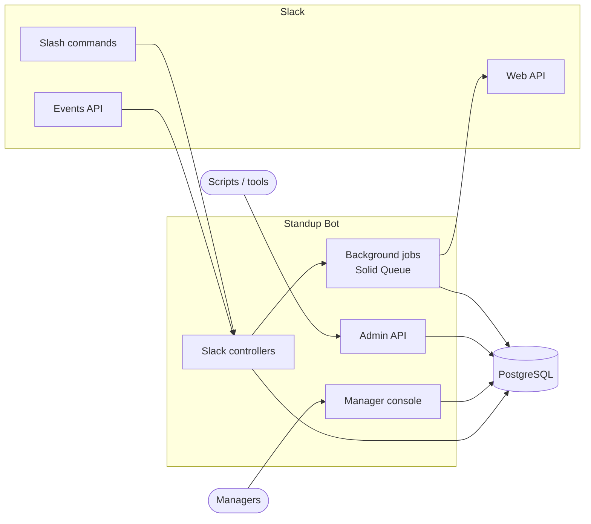
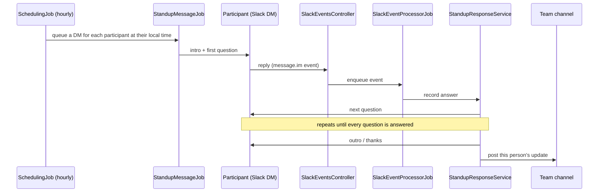
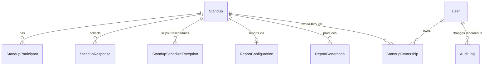

# Architecture

Standup Bot is a Rails 8 app. Most of it is API-only and serves Slack webhooks and a JSON admin API. On top of that sits a server-rendered web console for managers. Background work runs on Solid Queue, and production data lives in PostgreSQL (development and test use MySQL).

## The big picture

Requests from Slack are verified with the signing secret and then handed off to background jobs, so the app can respond to Slack quickly. All outgoing Slack calls go through `SlackClient`.

## A standup, end to end

If someone doesn't reply, `StandupReminderJob` nudges them (by default once, after two hours, and both are configurable per standup). Once they've been silent for `STALE_PENDING_DAYS`, `DataCleanupJob` marks the response as expired. A participant can also type `skip`, `cancel`, or `away` instead of answering (see [DM commands](slack-setup.md#dm-commands)).

## Data model

| Model | What it is |
| --- | --- |
| `Standup` | A team's standup: channel, schedule, questions, intro/outro, and reminder settings |
| `StandupParticipant` | A Slack user in a standup, with their cached timezone and any vacation dates |
| `StandupResponse` | One person's answers for one standup date, with a status of `pending`, `completed`, `skipped`, `cancelled`, or `expired` |
| `StandupScheduleException` | A one-off change to the schedule: a skipped date, holiday, cancellation, or new time |
| `ReportConfiguration` / `ReportGeneration` | Where and how summary reports are delivered, plus a record of each one generated |
| `User` | A manager or admin who can sign in to the web console |
| `StandupOwnership` | Links managers to the standups they can manage |
| `AuditLog` | A record of changes managers and admins make |

Schedules can be `daily`, `weekdays`, `weekly`, `biweekly`, `monthly`, or `custom`. You can also list holidays that apply to every standup in `config/holidays.yml`.

## Background jobs

| Job | When it runs | What it does |
| --- | --- | --- |
| `SchedulingJob` | Every hour | Finds standups due in the next window and queues a `StandupMessageJob` for each participant at their local time |
| `StandupMessageJob` | When queued | Opens the DM and sends the intro and first question |
| `SlackEventProcessorJob` | On each Slack event | Handles DM commands and records answers, including edits to earlier answers |
| `StandupReminderJob` | Every 15 minutes | Reminds people who haven't finished, based on each standup's reminder settings |
| `StandupCollectionJob` | On demand | Gathers completed responses into a report (for `/standup report` or the console) |
| `SlackUserReactivationJob` | When someone's `away` period ends | Puts the participant back in rotation |
| `DataCleanupJob` | Daily at 3am | Expires stale pending responses and deletes data older than the retention window |

Recurring schedules are defined in [`config/recurring.yml`](../config/recurring.yml). If you set `ADMIN_CHANNEL`, failed jobs post a message there.

## Web console, personas, and permissions

The web console uses cookie-backed sessions and serves three kinds of people:

- **Admins** (`User` with role `admin`) can manage every standup.
- **Standup owners** (`User` with the standard `manager` role) manage the standups linked to them through `StandupOwnership`. Anyone can create a standup, for example to run one for a virtual team, and owns the standups they create. Being an owner has nothing to do with the org chart.
- **Members** are the people in standups. A member is identified by Slack user ID, and the same person can be a `StandupParticipant` in several standups. `Member` (in `app/models/member.rb`) gathers those rows together.

"Sign in with Slack" (`SlackSessionsController` and `SlackSignIn`) uses Slack's OpenID Connect endpoints and is pinned to one workspace. `User.from_slack_identity` finds or creates the account:

1. It looks up an existing account by `slack_user_id`.
2. If there isn't one, it links an existing account by a Slack-verified email.
3. Otherwise it creates a standard account.

Slack guests are refused at sign-in. Since anyone else can sign in, non-admins only see public channels in channel discovery, and can only sync participants from channels they belong to.

Everyone signed in with Slack can use the console for the standups they own, and the member area under `/me` (`Me::*` controllers) for the standups they're in. Accounts can also sign in with an email and access token. Only a SHA-256 digest of the token is stored.

- **Admins** also get an **Admin** page (`/admin`) that shows database, job queue, and Slack health, usage, users, failed reports, and recent audit log entries.

The console is server-rendered ERB with Turbo. Styles live in [`public/application.css`](../public/application.css) and the small amount of client-side behavior (adding question rows, live schedule preview) in [`public/application.js`](../public/application.js). Shared building blocks are in `app/helpers/ui_helper.rb` (icons, badges, avatars) and `app/helpers/charts_helper.rb` (server-rendered SVG charts, so there's no charting dependency).

When you write new console controllers, scope records with `Standup.manageable_by(user)` or check `standup.manageable_by?(user)` / `user.can_manage_standup?(standup)`. Create, update, and delete actions should call `AuditLogger.log!` (or the controller helpers) so changes show up in `AuditLog`.

The [admin API](api.md) is separate. It uses a single global bearer token (`ADMIN_API_TOKEN`) rather than user accounts.
