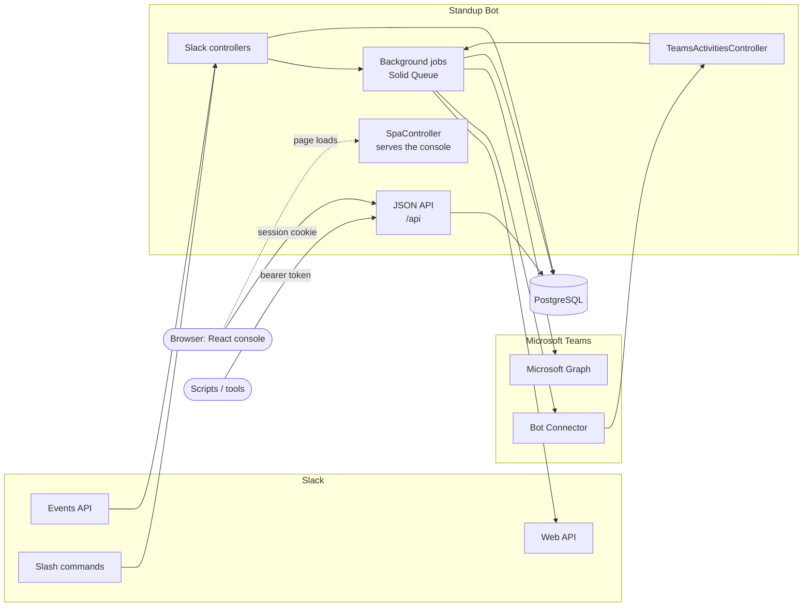
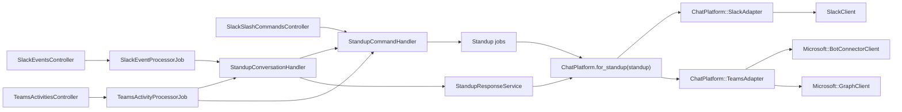
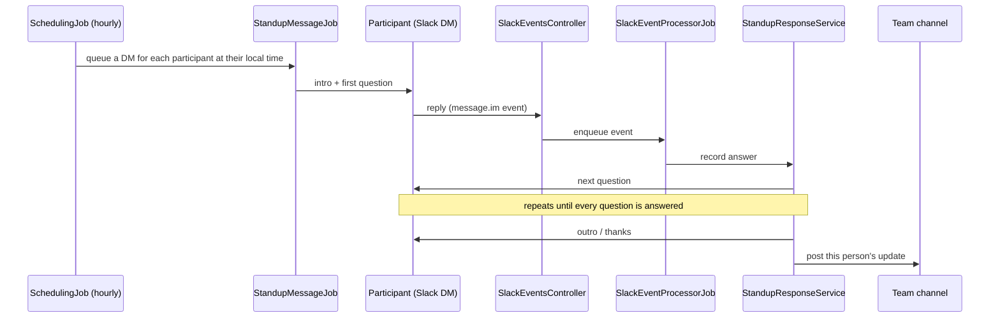
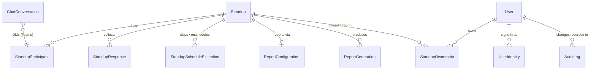
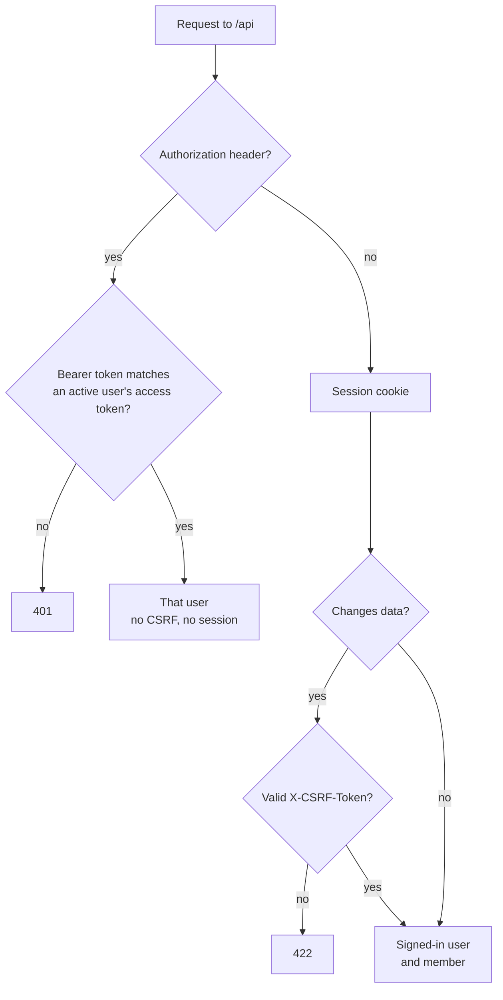
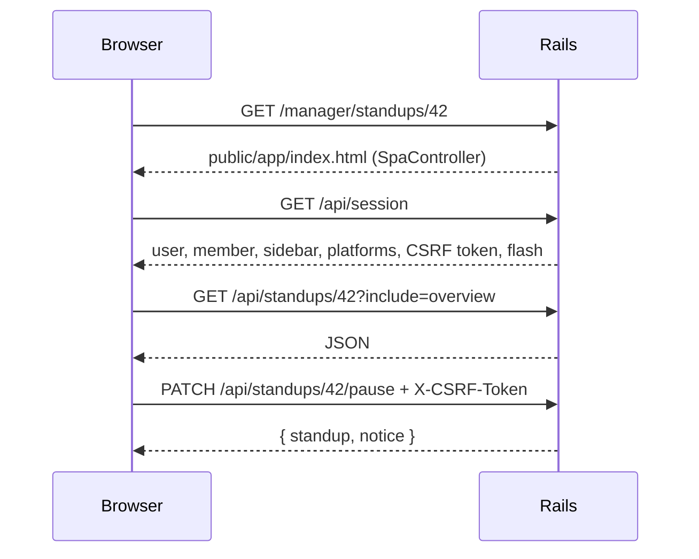

# Architecture

Standup Bot is a Rails 8 app. It's API-only: it serves Slack and Microsoft Teams webhooks and one JSON API under `/api`. The web console is a React single-page app (Primer React) that runs in the browser and talks to that same API. Background work runs on Solid Queue, and production data lives in PostgreSQL (development and test use MySQL).

## The big picture

Requests from Slack are verified with the signing secret, and requests from Teams with the Bot Framework JWT (`Microsoft::BotFrameworkAuth`). Both are then handed off to background jobs, so the app can respond quickly.

## Chat platform adapters

Standup logic doesn't talk to Slack or Teams directly. Each standup has a `platform`, and everything goes through that platform's adapter, so Slack and Teams standups run side by side in one deployment.

- `ChatPlatform::Adapter` defines the contract: sending DMs and channel messages, posting and editing a person's update, posting reports, offering a choice of standups, looking up people and channels, validating IDs and channels, and a `formatter` for bold, italic, code, and channel references. Every adapter's tests include `test/support/chat_platform_adapter_contract.rb`.
- `ChatPlatform::SlackAdapter` implements it with Block Kit and mrkdwn on top of `SlackClient`, the low-level Web API wrapper.
- `ChatPlatform::TeamsAdapter` implements it with Teams markdown and Adaptive Cards. It uses the Bot Connector to message people and channels, and Microsoft Graph to look people and channels up. People are identified by Entra object ID, and channels by `TEAM_ID|CHANNEL_ID`. Before the bot can DM someone it needs a 1:1 conversation, which it opens (or learns about from incoming activities) and caches in `ChatConversation`. See [Microsoft Teams setup](teams-setup.md).
- Inbound messages are normalized into a `ChatPlatform::InboundMessage` and handled by `StandupConversationHandler`. Slash commands, Teams @mentions, and DM keywords (`help`, `skip`, `away`, ...) all go through `StandupCommandHandler`, which returns `ChatPlatform::Reply` objects that each platform renders its own way (`Adapter#send_reply`): ephemeral Block Kit in Slack, chat messages and cards in Teams.
- `ChatIntegrationService` (with `SlackIntegrationService` and `TeamsIntegrationService`) backs the console's credential checks, discovery, and test messages. `ChatUserResolver` turns what someone typed into a person on the standup's platform.

## A standup, end to end

If someone doesn't reply, `StandupReminderJob` nudges them (by default once, after two hours, and both are configurable per standup). Once they've been silent for `STALE_PENDING_DAYS`, `DataCleanupJob` marks the response as expired. A participant can also type `skip`, `cancel`, or `away` instead of answering (see [DM commands](slack-setup.md#dm-commands)).

## Data model

| Model | What it is |
| --- | --- |
| `Standup` | A team's standup: chat `platform`, channel, schedule, questions, intro/outro, and reminder settings. The platform is fixed once the standup exists |
| `StandupParticipant` | A person in a standup, identified by `platform_user_id` on the standup's platform, with their cached timezone and any vacation dates |
| `StandupResponse` | One person's answers for one standup date, with a status of `pending`, `completed`, `skipped`, `cancelled`, or `expired` |
| `StandupScheduleException` | A one-off change to the schedule: a skipped date, holiday, cancellation, or new time |
| `ReportConfiguration` / `ReportGeneration` | Where and how summary reports are delivered, plus a record of each one generated |
| `User` | A manager or admin who can sign in to the web console |
| `UserIdentity` | Links a `User` to their user ID on a chat platform, at most one per platform |
| `ChatConversation` | The bot's cached 1:1 conversation with a person, for platforms that need one before sending a DM (Teams) |
| `StandupOwnership` | Links managers to the standups they can manage |
| `AuditLog` | A record of changes managers and admins make |

The app doesn't use database foreign key constraints. Models own referential cleanup through `dependent:` options on their associations (for example, deleting a standup destroys its participants and reports, and deleting a user nullifies `actor_id` on their audit logs and report generations). A test checks that no foreign keys creep back into the app schema. Solid Queue's own tables keep the foreign keys that ship with the gem.

Schedules can be `daily`, `weekdays`, `weekly`, `biweekly`, `monthly`, or `custom`. You can also list holidays that apply to every standup in `config/holidays.yml`.

## Background jobs

| Job | When it runs | What it does |
| --- | --- | --- |
| `SchedulingJob` | Every hour | Finds standups due in the next window and queues a `StandupMessageJob` for each participant at their local time |
| `StandupMessageJob` | When queued | Opens the DM and sends the intro and first question |
| `SlackEventProcessorJob` | On each Slack event | Handles DM commands and records answers, including edits to earlier answers |
| `TeamsActivityProcessorJob` | On each Teams activity | The same for Teams, plus `standup` commands and card choices. It also caches the 1:1 conversation |
| `StandupReminderJob` | Every 15 minutes | Reminds people who haven't finished, based on each standup's reminder settings |
| `StandupCollectionJob` | On demand | Gathers completed responses into a report (for `/standup report` or the console) |
| `SlackUserReactivationJob` | When someone's `away` period ends | Puts the participant back in rotation |
| `DataCleanupJob` | Daily at 3am | Expires stale pending responses and deletes data older than the retention window |

Recurring schedules are defined in [`config/recurring.yml`](../config/recurring.yml). If you set `ADMIN_CHANNEL` (Slack) or `TEAMS_ADMIN_CHANNEL` (Teams), failed jobs post a message there.

## Web console, personas, and permissions

The web console uses cookie-backed sessions and serves three kinds of people:

- **Admins** (`User` with role `admin`) can manage every standup.
- **Standup owners** (`User` with the standard `manager` role) manage the standups linked to them through `StandupOwnership`. Anyone can create a standup, for example to run one for a virtual team, and owns the standups they create. Being an owner has nothing to do with the org chart.
- **Members** are the people in standups. A member is identified by their platform and user ID on it, and the same person can be a `StandupParticipant` in several standups. `Member` (in `app/models/member.rb`) gathers those rows together.

"Sign in with Slack" (`SlackSessionsController` and `SlackSignIn`) uses Slack's OpenID Connect endpoints and is pinned to one workspace. "Sign in with Microsoft" (`MicrosoftSessionsController` and `MicrosoftSignIn`) uses Entra ID OpenID Connect, validates the ID token (`Microsoft::IdTokenVerifier`), and is pinned to `TEAMS_TENANT_ID`. Both share `PlatformSignIn`, and `User.from_identity(platform, identity)` finds or creates the account:

1. It looks up an existing account by its Slack `UserIdentity`.
2. If there isn't one, it links an existing account by a Slack-verified email.
3. Otherwise it creates a standard account.

Anyone who manages a standup can make other people in it managers, or remove them, from the Participants tab (`Api::StandupManagersController`). This creates or removes a `StandupOwnership` for that standup only. Someone who has never signed in gets an account tied to their user ID on the standup's platform, and they're matched to it when they first sign in. A standup always keeps at least one manager.

### One API, two ways in

Everything the console shows comes from `/api`, the same API that scripts use. Every request acts as a user, who can arrive one of two ways, and `Api::BaseController` picks exactly one per request:

A wrong token is always rejected; it never falls back to the cookie. Both ways end up as a `Principal` (`app/models/principal.rb`) for the same user, so authorization doesn't care how someone arrived: admins can manage every standup, and everyone else only the standups they own. Audit log entries record that user, with `auth_method: "access_token"` for token requests. Tokens are looked up by their SHA-256 digest, and a digest shared by two accounts is refused.

Every `/api` action has to check authorization. `Api::BaseController` runs `verify_authorized` after each action, and it raises `AuthorizationNotPerformed` unless the action called one of:

- `authorize_standup!`, for actions on one standup (`set_standup` does this for nested routes)
- `require_admin!`, for admin-only endpoints
- `require_member!`, for the member area (`/api/me/*`), which only reads the signed-in member's own data and needs a session
- `skip_authorization`, for actions any signed-in user may take, such as creating a standup or listing the ones they manage

`test/controllers/api/authorization_check_test.rb` fails if any routed `/api` controller is missing this check.

Avatars use each person's Slack photo when we have one. Teams photos aren't public URLs, so Teams participants show initials. `avatar_url` on `StandupParticipant` and `User` is filled in whenever the app already talks to Slack about that person: user search and resolution, channel sync, timezone refresh, and Slack sign-in, which also refreshes that person's participant rows. `StandupParticipant` and `User` only store `https` URLs (`AvatarUrl`), so serializers can pass them straight through. If a photo is missing or fails to load, the avatar falls back to initials.

Slack and Microsoft guests are refused at sign-in. Since anyone else can sign in, non-admins only see public channels in channel discovery, and can only sync participants from channels they belong to.

Everyone signed in with Slack or Microsoft can use the console for the standups they own, and the member area under `/me` for the standups they're in. Accounts can also sign in with an email and access token. Only a SHA-256 digest of the token is stored.

- **Admins** also get an **Admin** page (`/admin`) that shows database, job queue, and Slack health, usage, users, failed reports, and recent audit log entries.

### The console

The console lives in [`frontend/`](../frontend). It's a Vite + TypeScript + React app built with [Primer React](https://primer.style/product/getting-started/react/) and Octicons, and `vite build` writes it to `public/app`.

- Console URLs are the same as before (`/manager/standups/:id/participants`, `/me/responses`, `/admin`, and so on). `SpaController` serves the app for any browser navigation that isn't `/api`, `/slack`, `/teams`, `/auth`, or a health check, and React Router takes it from there.
- "Sign in with Slack" and "Sign in with Microsoft" are still server-side redirects under `/auth`. When they finish, they send people to a console URL. Any error shows up as a flash, which `GET /api/session` hands to the app once.
- Serializers in `app/serializers/` shape the JSON. They also compute display values such as schedule summaries, status labels and tones, and per-platform wording (`UiFormat`, `PlatformSerializer`), so the browser doesn't reimplement scheduling rules.
- Charts are small SVG components in `frontend/src/components/charts`, so there's no charting dependency.

When you add a console feature, add or extend an `Api::` endpoint first. Scope records with `principal.manageable_standups` or `set_standup`, and record changes with `audit_change!` so they show up in `AuditLog`. Then build the page in `frontend/src/pages` (see [`frontend/README.md`](../frontend/README.md)).

See [API](api.md) for using the API from scripts with an access token.
