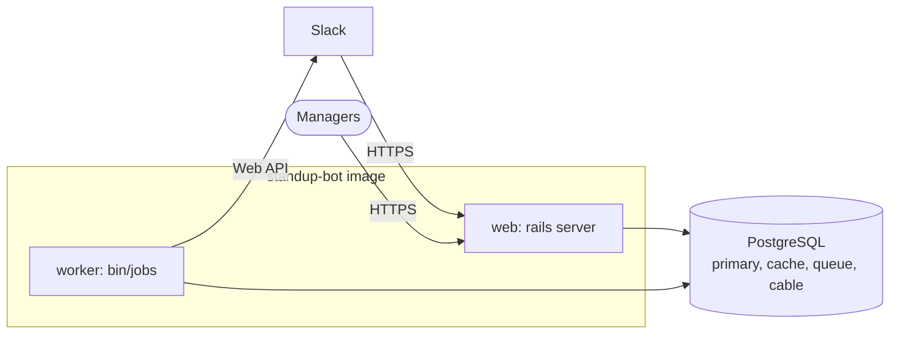

# Deployment

Standup Bot ships as a single Docker image. The image build compiles the web console (`frontend/`) in a Node stage and copies only the result into `public/app`, so the running image doesn't need Node. Every deployment runs two processes from that image:

- **Web** (`./bin/thrust ./bin/rails server`, on port 80) serves Slack webhooks, the web console, and the API.
- **Worker** (`bin/jobs`) runs scheduling, DMs, reminders, and cleanup. Without it, no standups go out.

Both run `bin/rails db:prepare` on startup, so migrations are applied automatically. If you'd rather not run a separate worker, set `SOLID_QUEUE_IN_PUMA=1` to run jobs inside the web process.



## What you need

- PostgreSQL (Compose uses version 16). Point `DATABASE_URL` at the main database and `CACHE_DATABASE_URL`, `QUEUE_DATABASE_URL`, and `CABLE_DATABASE_URL` at the other three. They can all be on the same server.
- `RAILS_MASTER_KEY` (or `SECRET_KEY_BASE`)
- `SLACK_BOT_TOKEN` and `SLACK_SIGNING_SECRET` for Slack, and/or `TEAMS_APP_ID`, `TEAMS_APP_PASSWORD`, and `TEAMS_TENANT_ID` for [Microsoft Teams](teams-setup.md)
- `ADMIN_API_TOKEN`, if you use the API
- `APP_HOSTS` set to your public hostname

See [Configuration](configuration.md) for everything else. Once the app is running, create your first admin by setting `MANAGER_ADMIN_EMAIL` and `MANAGER_ADMIN_TOKEN` and running `bin/rails db:seed`, or [use the Rails console](configuration.md#manager-accounts).

## Docker

```bash
docker build -t standup-bot .

docker run -d -p 80:80 \
  -e RAILS_MASTER_KEY=... \
  -e DATABASE_URL=... \
  -e SLACK_BOT_TOKEN=... \
  -e SLACK_SIGNING_SECRET=... \
  standup-bot

# and the worker, using the same image and environment
docker run -d -e RAILS_MASTER_KEY=... -e DATABASE_URL=... ... standup-bot bin/jobs
```

[`docker-compose.yml`](../docker-compose.yml) is a working example of the full setup (web, worker, and Postgres) that you can adapt.

## Kamal

[`config/deploy.yml`](../config/deploy.yml) defines `web` and `job` roles. Fill in your servers, registry, and hostname, put the secrets in `.kamal/secrets`, and run:

```bash
bin/kamal setup    # first time
bin/kamal deploy
```

## Kubernetes

[`config/kubernetes/production/`](../config/kubernetes/production/) has example manifests: a Deployment with an init container that runs `standups:import` from a `standup-configs` ConfigMap, a Service, and a CronJob. Treat these as a starting point rather than something ready to apply. In particular, you'll need a worker Deployment running `bin/jobs`, and once it's running, the worker's built-in recurring schedule (see [`config/recurring.yml`](../config/recurring.yml)) replaces the CronJob.
