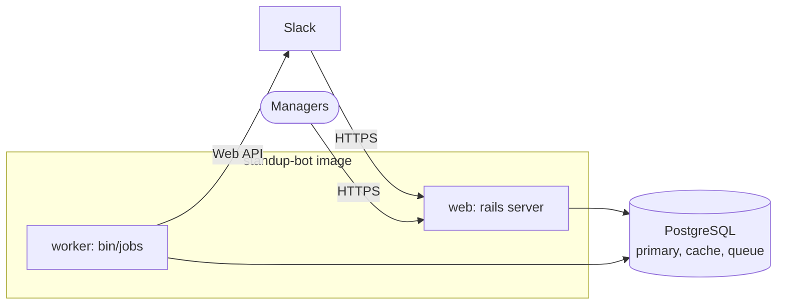

# Deployment

Standup Bot ships as a single Docker image. The image build compiles the web console (`frontend/`) in a Node stage and copies only the result into `public/app`, so the running image doesn't need Node. Every deployment runs two processes from that image:

- **Web** (`./bin/thrust ./bin/rails server`, on port 80) serves Slack webhooks, the web console, and the API.
- **Worker** (`bin/jobs`) runs scheduling, DMs, reminders, and cleanup. Without it, no standups go out.

Both run `bin/rails db:prepare` on startup, so migrations are applied automatically. If you'd rather not run a separate worker, set `SOLID_QUEUE_IN_PUMA=1` to run jobs inside the web process.

If Slack can't reach your app over the internet, use [Socket Mode](slack-setup.md#run-the-socket-mode-client) (`SLACK_CONNECTION_MODE=socket`). Then a third process, `bin/slack-socket-mode`, holds an outbound connection to Slack instead of Slack calling the web server. Set `SLACK_SOCKET_MODE_IN_PUMA=1` to run it inside the web process instead.



## What you need

- PostgreSQL (Compose uses version 16). Point `DATABASE_URL` at the main database and `CACHE_DATABASE_URL` and `QUEUE_DATABASE_URL` at the other two. They can all be on the same server.
- `RAILS_MASTER_KEY` (or `SECRET_KEY_BASE`)
- `SLACK_BOT_TOKEN` and `SLACK_SIGNING_SECRET` for Slack (or `SLACK_CONNECTION_MODE=socket` and `SLACK_APP_TOKEN` instead of the signing secret for Socket Mode), and/or `TEAMS_APP_ID`, `TEAMS_APP_PASSWORD`, and `TEAMS_TENANT_ID` for [Microsoft Teams](teams-setup.md)
- `APP_HOSTS` set to your public hostname

See [Configuration](configuration.md) for everything else. Once the app is running, create your first admin by setting `MANAGER_ADMIN_EMAIL` and `MANAGER_ADMIN_TOKEN` and running `bin/rails db:seed`, or [use the Rails console](configuration.md#manager-accounts).

## Docker

```bash
docker build -t standup-bot .

docker run -d -p 80:80 \
  -e RAILS_MASTER_KEY=... \
  -e DATABASE_URL=... \
  -e SLACK_BOT_TOKEN=... \
  -e SLACK_SIGNING_SECRET=... \
  standup-bot

# and the worker, using the same image and environment
docker run -d -e RAILS_MASTER_KEY=... -e DATABASE_URL=... ... standup-bot bin/jobs

# in Socket Mode, also the Slack connection
docker run -d -e SLACK_CONNECTION_MODE=socket -e SLACK_APP_TOKEN=xapp-... ... standup-bot bin/slack-socket-mode
```

[`docker-compose.yml`](../docker-compose.yml) is a working example of the full setup (web, worker, and Postgres) that you can adapt.

## Kamal

[`config/deploy.yml`](../config/deploy.yml) defines `web` and `job` roles, plus a commented-out `slack_socket_mode` role for Socket Mode. Fill in your servers, registry, and hostname, put the secrets in `.kamal/secrets`, and run:

```bash
bin/kamal setup    # first time
bin/kamal deploy
```

## Kubernetes

[`config/kubernetes/production/`](../config/kubernetes/production/) has example manifests. Replace the image, fill in the `standupbot-secrets` Secret (`RAILS_MASTER_KEY`, the three database URLs, and the Slack or Teams credentials), and adjust `standupbot-config`. The containers set `args`, not `command`, so the image's entrypoint (which prepares the database) still runs.

| Manifest | Runs | Notes |
| --- | --- | --- |
| `deployments/standupbot-web.yaml` | Puma on port 3000 (`standupbot-web` Service) | The entrypoint runs `db:prepare` first. A `preStop` sleep lets the Service stop routing to a pod before Puma drains. |
| `deployments/standupbot-jobs.yaml` | `bin/jobs` | Also runs the recurring schedule, so there's no CronJob. Recurring runs are deduplicated across replicas. Ready once its workers are registered and heartbeating. |
| `jobs/standupbot-import-standups.yaml` | `standups:import` | Optional. Loads standups from a `standup-configs` ConfigMap. Run it once per deploy (delete the old Job first); running it from every pod could create the same standup twice. |
| `deployments/standupbot-slack-socket-mode.yaml` | `bin/slack-socket-mode` | Socket Mode only. Ready only while connected to Slack. |
| `policies/standupbot-pdb.yaml` | PodDisruptionBudgets | Keeps one of each through node drains. |

All three Deployments run 2 replicas and roll out with `maxSurge: 1` and `maxUnavailable: 0`, so a new pod is ready before an old one stops:

- **Socket Mode:** Slack sends each event to one open connection (up to 10 per app, counting the extra pod during a rollout). A stopping pod closes its connection, and Slack redelivers anything it hadn't acknowledged to another pod. If every pod is down for longer than Slack keeps redelivering (about 5 minutes), the first pod to reconnect reads missed replies from DM history. In HTTP mode, run `bin/rails slack:backfill_dms` after an outage like that.
- **Workers:** on SIGTERM, Solid Queue stops taking jobs and gives running ones `SOLID_QUEUE_SHUTDOWN_TIMEOUT` seconds to finish; anything unfinished goes back on the queue. Messages people send are recorded once even if a job runs twice, and an answer is saved before anything is posted.

Replicas are for availability, not speed. Slack limits how many messages a workspace can send a minute, so a standup going to everyone at once is paced by `STANDUP_SEND_CONCURRENCY` (2 by default). See [Reliability](architecture.md#reliability) for how messages are kept from being lost or doubled.

