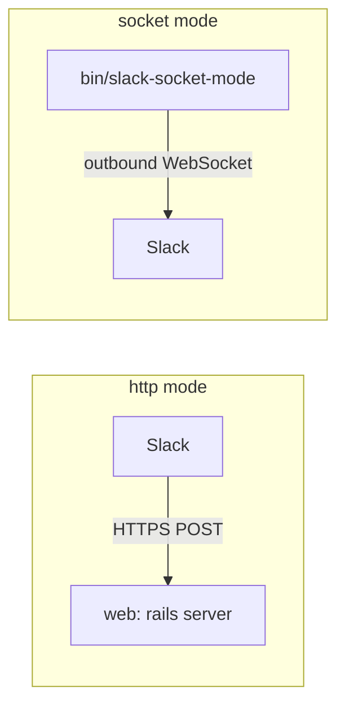

# Slack setup

To send and receive messages, Standup Bot needs a Slack app installed in your workspace. Slack can deliver DMs, slash commands, and button clicks to the app in one of two ways, set with `SLACK_CONNECTION_MODE`:

| Mode | How Slack reaches the app | Use it when |
| --- | --- | --- |
| `http` (default) | Slack sends HTTPS requests to the app's `/slack/...` URLs, signed with the app's signing secret | The app has a public HTTPS URL |
| `socket` | The app opens an outbound WebSocket to Slack ([Socket Mode](https://api.slack.com/apis/socket-mode)) using an app-level token | The app sits behind a firewall or has no public URL, or you're developing locally and don't want a tunnel |



Either way, the bot sends messages with the same bot token, and everything else (jobs, the console, the API) works the same. You can switch modes later; see [Switching modes](#switching-modes).

## 1. Get a public URL (HTTP mode only)

In HTTP mode, Slack has to be able to reach your app over HTTPS. In production, this is your app's domain. For local testing, start Rails and expose it with a tunnel such as [ngrok](https://ngrok.com/):

```bash
ngrok http 3000
```

Copy the `https://…ngrok-free.app` URL that ngrok gives you.

In Socket Mode, skip this step. You only need a URL if you want [Sign in with Slack](#sign-in-with-slack-optional), and then it only has to be reachable from people's browsers.

## 2. Create the Slack app from a manifest

The app can generate a Slack app manifest with all the scopes, events, and slash commands it needs:

```bash
# HTTP mode
APP_URL=https://your-domain.example bin/rails slack:manifest > slack-manifest.yml

# Socket Mode (APP_URL is optional, and only adds the Sign in with Slack redirect)
SLACK_CONNECTION_MODE=socket bin/rails slack:manifest > slack-manifest.yml
```

Then go to [api.slack.com/apps](https://api.slack.com/apps), choose **Create New App → From an app manifest**, pick your workspace, and paste in `slack-manifest.yml`.

<details>
<summary>What the manifest sets up (if you'd rather configure the app by hand)</summary>

**Bot token scopes** (under **OAuth & Permissions**):

| Scope | Why |
| --- | --- |
| `channels:read` | Look up channels to post summaries to |
| `chat:write` | Send messages as the bot |
| `commands` | Receive slash commands |
| `im:history` | Receive participants' DM replies |
| `im:write` | Start DMs with participants |
| `users:read` | Look up people and their timezones |

**Event subscriptions**: subscribe to the `message.im` bot event. In HTTP mode, set the request URL to `https://your-domain/slack/events`.

**Interactivity**: turn it on. In HTTP mode, set the request URL to `https://your-domain/slack/interactions`.

**Slash commands**: create `/standup` and `/standup-status`. In HTTP mode, their request URLs are:

| Command | Request URL |
| --- | --- |
| `/standup` | `https://your-domain/slack/commands/standup` |
| `/standup-status` | `https://your-domain/slack/commands/standup-status` |

**Socket Mode** (under **Settings → Socket Mode**): on for Socket Mode, off for HTTP mode.

**App Home** (under **Features → App Home**): turn on the **Messages Tab** and tick **Allow users to send Slash commands and messages from the messages tab**, so participants can reply to the bot in its DM.

</details>

## 3. Install the app and set credentials

1. Under **Install App**, install the app to your workspace.
2. Copy the **Bot User OAuth Token** (it starts with `xoxb-`).
3. Get the credential for your mode:
   - **HTTP mode:** under **Basic Information**, copy the **Signing Secret**.
   - **Socket Mode:** under **Basic Information → App-Level Tokens**, choose **Generate Token and Scopes**, add the `connections:write` scope, and copy the token (it starts with `xapp-`). Manifests can't create this token, so this step is always manual.
4. Set them as environment variables and restart the app:

```bash
# HTTP mode
SLACK_BOT_TOKEN=xoxb-...
SLACK_SIGNING_SECRET=...

# Socket Mode
SLACK_CONNECTION_MODE=socket
SLACK_BOT_TOKEN=xoxb-...
SLACK_APP_TOKEN=xapp-...
```

### Run the Socket Mode client

In Socket Mode, something has to hold the WebSocket open. Pick one:

- **A separate process:** run `bin/slack-socket-mode` from the same image and environment as the web server. It reconnects on its own, including when Slack refreshes the connection every few hours. With Docker Compose, run `docker compose --profile slack-socket-mode up`. With Kamal, uncomment the `slack_socket_mode` role in [`config/deploy.yml`](../config/deploy.yml).
- **Inside the web server:** set `SLACK_SOCKET_MODE_IN_PUMA=1`, like `SOLID_QUEUE_IN_PUMA`, and the web process opens the connection itself.

Locally, `bin/dev` (and so `script/server`) starts `bin/slack-socket-mode` for you when `SLACK_CONNECTION_MODE=socket`.

Slack allows up to 10 Socket Mode connections per app and sends each event to just one of them, so it's fine to run more than one, for example one per web replica.

The **Integrations** page in the web console shows whether these are configured for your mode, and the **Admin** page shows when the Socket Mode client last connected. In each standup, **Settings > General** sets its channel and has a **Send test message** button, and the **People** tab adds people by `@username`.

### Sign in with Slack (optional)

Team members, managers, and admins can sign in to the web console with their Slack account. To turn this on:

1. Under **OAuth & Permissions**, add `https://your-domain/auth/slack/callback` as a **Redirect URL**, and add the `openid`, `email`, and `profile` **User Token Scopes**. Manifests generated with `bin/rails slack:manifest` already include these (in Socket Mode, only when you pass `APP_URL`).
2. Under **Basic Information**, copy the **Client ID** and **Client Secret** and set them as `SLACK_CLIENT_ID` and `SLACK_CLIENT_SECRET`.
3. Optionally set `SLACK_TEAM_ID` (it starts with `T`). Sign-in is always limited to one workspace: this one, or the bot token's workspace if `SLACK_TEAM_ID` isn't set.

Anyone in the workspace can sign in with Slack, except guests (single- and multi-channel guests):

- If they don't have an account yet, they get one automatically. They can then create standups, for example for a virtual team, and manage the ones they own.
- An existing account is linked by Slack user ID, or by email when Slack has verified it. Admins keep their admin access.
- People in at least one standup also get **My standups**, where they can see their check-ins, their past answers, and set time away.

Because anyone can sign in, some Slack lookups are limited for non-admins. Channel search only shows public channels, and "Sync from a Slack channel" only works for channels the person is in. Admins can do both for any channel.

Email and access token sign-in still works.

## 4. Try it out

Send the bot a DM with `help`. If nothing comes back, check the Rails logs (or the `bin/slack-socket-mode` logs in Socket Mode) to see whether the event arrived (see [Troubleshooting](development.md#troubleshooting)).

## Switching modes

To move an existing app from HTTP to Socket Mode:

1. In the Slack app's settings, turn on **Settings → Socket Mode**. Slack asks you to create an app-level token with `connections:write`; copy it.
2. Set `SLACK_CONNECTION_MODE=socket` and `SLACK_APP_TOKEN=xapp-...`, start `bin/slack-socket-mode` (or set `SLACK_SOCKET_MODE_IN_PUMA=1`), and restart the app.

While Socket Mode is on, Slack stops calling the request URLs. To go back, turn Socket Mode off in Slack, make sure the request URLs point at your app (regenerate the manifest with `APP_URL` if needed), set `SLACK_CONNECTION_MODE=http` and `SLACK_SIGNING_SECRET`, and stop the Socket Mode client.

## What participants can do

### Slash commands

| Command | What it does |
| --- | --- |
| `/standup` or `/standup start` | Start your standup now |
| `/standup status` | Check the status of your current standup |
| `/standup skip` | Skip your pending standup |
| `/standup report` | Get a standup report |
| `/standup history [days]` | See your recent standups (defaults to the last 7 days) |
| `/standup help` | List the commands |
| `/standup-status` | Shortcut for `/standup status` |

### DM commands

Participants can also type these in their DM with the bot:

| Command | What it does |
| --- | --- |
| `skip` | Skip the current question |
| `cancel` | Cancel the current standup |
| `away [days]` | Mark yourself away (optionally for a number of days) |
| `back` | Come back from being away |
| `report` | Get a standup report |
| `help` | List the commands |
