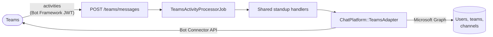

# Microsoft Teams setup

Standup Bot can run standups in Microsoft Teams as well as Slack. Each standup picks its platform when it's created, so one deployment can serve Slack teams and Teams teams side by side.

Teams works the same way as Slack: people get their questions in a 1:1 chat with the bot, answer them there, and each finished update is posted to the team's channel as a new thread. Reminders, [edits to answers](slack-setup.md#editing-answers), DM commands (`skip`, `cancel`, `away`, `back`, `help`), reports, and the `standup` commands all work in Teams.



## 1. Register the bot

1. In the Azure portal, create an **Azure Bot** resource. Choose **Single Tenant** and let it create a new Microsoft Entra app registration (or pick an existing one).
2. Under **Configuration**, set the messaging endpoint to `https://YOUR-DOMAIN/teams/messages`.
3. Under **Channels**, add **Microsoft Teams**.
4. Open the bot's app registration in **Microsoft Entra ID → App registrations** and note:
   - the **Application (client) ID** → `TEAMS_APP_ID`
   - the **Directory (tenant) ID** → `TEAMS_TENANT_ID`
5. Under **Certificates & secrets**, create a client secret → `TEAMS_APP_PASSWORD`.

## 2. Grant Graph permissions

The bot uses Microsoft Graph with application permissions to look people up, find channels, and sync channel members. In the app registration, open **API permissions → Add a permission → Microsoft Graph → Application permissions**, add these, then click **Grant admin consent**:

| Permission | Used for |
| --- | --- |
| `User.Read.All` | Looking up names, emails, and guest status |
| `MailboxSettings.Read` | Reading each person's time zone |
| `Team.ReadBasic.All` | Listing teams for channel discovery |
| `Channel.ReadBasic.All` | Listing channels for channel discovery |
| `ChannelMember.Read.All` | Syncing participants from a channel |
| `TeamsAppInstallation.ReadWriteForUser.All` | _Optional._ Installing the app for participants who haven't installed it |

## 3. Upload the Teams app

Generate the app manifest:

```bash
APP_URL=https://your-domain.example TEAMS_APP_ID=<application id> bin/rails teams:manifest > manifest.json
```

Zip `manifest.json` with two icons: a 192×192 `color.png` and a 32×32 transparent `outline.png`. Upload the zip in the **Teams admin center** (**Teams apps → Manage apps → Upload new app**) so it's available to your organization, then add it to the teams whose channels you'll post to.

The bot can only start a chat with someone who has the app installed. Either install it for people (an app setup policy works well), or set `TEAMS_APP_CATALOG_ID` to the app's ID from **Manage apps** and grant `TeamsAppInstallation.ReadWriteForUser.All`. Then the bot installs itself for a participant the first time it needs to message them.

## 4. Configure Standup Bot

| Variable | Required | Description |
| --- | --- | --- |
| `TEAMS_APP_ID` | Yes, to use Teams | Application (client) ID of the bot's app registration |
| `TEAMS_APP_PASSWORD` | Yes, to use Teams | Client secret for that app registration |
| `TEAMS_TENANT_ID` | Yes, to use Teams | Your Microsoft Entra tenant. The bot only accepts activities and sign-ins from this tenant |
| `TEAMS_SERVICE_URL` | No | Bot Connector URL for proactive messages before a conversation tells us a regional one. Defaults to `https://smba.trafficmanager.net/teams/`. Government clouds need their own URL |
| `TEAMS_APP_CATALOG_ID` | No | Lets the bot install itself for participants (see above) |
| `TEAMS_ADMIN_CHANNEL` | No | `TEAM_ID\|CHANNEL_ID` that gets a message when a background job fails |
| `TEAMS_SIGN_IN_CLIENT_ID`, `TEAMS_SIGN_IN_CLIENT_SECRET` | No | A separate app registration for "Sign in with Microsoft". Defaults to the bot's |

Restart the app, then check **Integrations → Microsoft Teams** in the console. It shows which settings are present and whether the bot can get tokens.

## Sign in with Microsoft

When Teams is configured, the sign-in page shows **Sign in with Microsoft**. Add `https://YOUR-DOMAIN/auth/microsoft/callback` as a **Web** redirect URI on the app registration. Sign-in is pinned to `TEAMS_TENANT_ID`, and guest accounts are refused, the same as with Slack.

People are matched by their Entra object ID. Entra's `email` claim isn't verified by default, so a Microsoft sign-in only links to an existing console account with the same email when the tenant sends the `xms_edov` (email domain owner verified) optional claim. Otherwise it creates a new account.

## Creating a Teams standup

In **New standup**, pick **Microsoft Teams**. The channel field becomes a list of your teams' channels. Standups store Teams channels as `TEAM_ID|CHANNEL_ID`, because Graph needs the team to list members and the Bot Connector needs the channel to post. People are identified by their Entra object ID. You can add them by name, email, or ID, or sync them from the channel.

A standup's platform is fixed once it's created.

## Commands in Teams

In the 1:1 chat with the bot:

- `standup`, `standup status`, `standup skip`, `standup report`, `standup history [days]`, `standup help`: the same as Slack's `/standup` commands. When there's a choice to make, the bot sends a card to pick the standup.
- `skip`, `cancel`, `away [days]`, `back`, `help`: the [DM commands](slack-setup.md#dm-commands).

Anything else is treated as an answer to the current question, including text that just happens to start with "standup".

In a channel or group chat, @mention the bot with a command (for example `@Standup Bot status`). It answers in your 1:1 chat so the reply stays private.

## Troubleshooting

- **"The Standup Bot app isn't installed for them"**: the person hasn't installed the app. Install it for them, or set `TEAMS_APP_CATALOG_ID`.
- **401s on `/teams/messages`**: check that `TEAMS_APP_ID` matches the Azure Bot's app ID. The bot rejects any request whose Bot Framework token wasn't issued for it.
- **Channel posts fail with 403**: the app needs to be added to the team that owns the channel.
- **Everyone shows up in UTC**: grant `MailboxSettings.Read`. Without it, the bot can't read time zones and falls back to the standup's.
